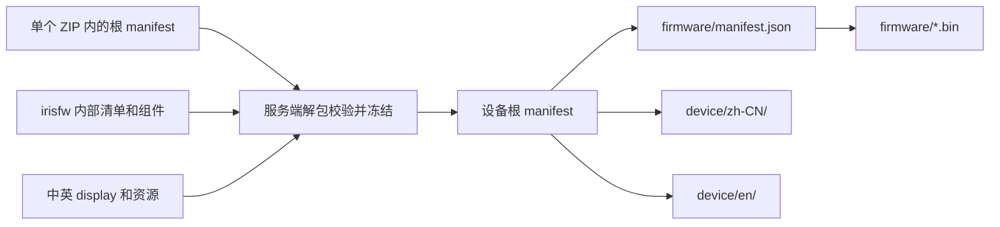
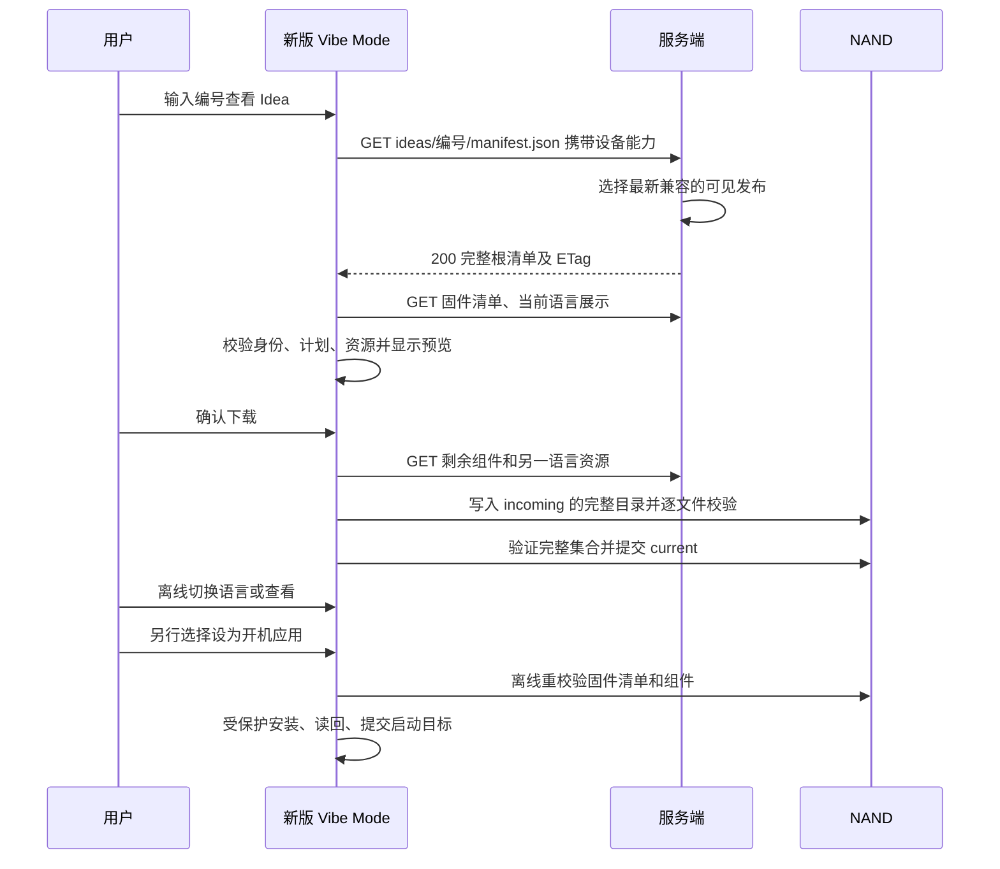

# Mosaico Ideas 文件发布与设备下载协议草案

更新日期：2026-10-14。面向 Mosaico Ideas 服务端、mosaico-tools 与 ESP-Mosaico Vibe Mode 联调人员。

上传采用**一个 ZIP 压缩包**，内部是由根目录 `manifest.json` 描述的完整、不可变文件集合，固件继续使用 `.irisfw`。设备**直接 GET 外层 manifest**，再按引用逐文件下载并保留目录层级；完整保存中英资源后可以离线切换语言。**Vibe Mode 自更新属于独立流程，不在本次协议范围内。**

**本文为已确认首版约定的协议草案，仓库已提供 CLI、设备实现与本地测试服务器。** 文件验收、容量与字段上限、兼容选版、接口契约、作者输入方式和语言行为均作为实现与验收依据；时限采用下文的可配置默认值。生产服务器接入、容量极限与实机耐久验证仍须分别验收；本地测试服务器不代表生产服务已上线。

实现分层见[代码实施计划](implementation-plan.zh-CN.md)，可执行联调步骤见[测试服务器与验收](testing.zh-CN.md)，已完成的全链路结果见[实机验收记录](acceptance.zh-CN.md)。

## 已确认范围与实现边界

| 事项 | 本次目标 | 当前实现或边界 |
| --- | --- | --- |
| 上传 | 一次提交一个 ZIP；包内清单完整描述内容，每个文件只声明一次 | project package/validate/upload 已实现；本地服务器接收单 ZIP |
| 设备下载 | 同一次 GET 携带设备能力，直接返回最新兼容发布的外层 manifest；保留 firmware/ 和 device/语言/ 层级，无 resolve 步骤 | 设备已解析 device-release/1、保留目录并固定快照 |
| Vibe Mode 自更新 | 独立流程，本次不定义 | 本协议及 Schema 只接受普通 Idea，不开放系统固件写入 |
| 格式范围 | 仅实现本文定义的新发布与下载格式，不支持 V0.1 | 不增加旧格式读取、转换、迁移矩阵或兼容测试分支 |
| 中英双语 | 系统 UI，以及 Ideas 名称、描述；首次默认中文，离线切换并保存偏好；列表复用名称字形块 | 内置双语文案/字体、NVS 语言偏好，列表及详情复用离线字形 |
| 文件验收 | 图片编码/像素、封面数量/大小、ZIP 总量、文件计数及字段限制按下文执行 | 工具与服务器共享实际内容校验器，设备独立校验下载集合 |
| 实施范围 | CLI、测试服务器、设备与测试 | Recovery ABI 和已审核二进制保持稳定；候选固件独立验收 |

产品基线为 0.2、Recovery ABI 2、layout version 5。Recovery 的路径、命令和 ABI 名称保持稳定；用户界面使用 Vibe Mode，芯片下载程序称 ROM Download Mode。

工具负责生成冻结集合、摘要和展示资源。服务端负责身份、权限、事务、格式与内容校验、不可变存储和发布索引。设备负责新格式解析、独立安全校验、目录存储、双语 UI，以及用户确认后的普通应用安装。

上传完成只产生草稿，不连接设备、不自动送审或发布。账户、所有权、审核状态、可见发布指针和统计属于服务端状态；数据库中的标题、内容索引与设备下载清单均由已冻结内容派生。

## 减少重复：每份描述只负责一层

| 描述 | 唯一负责的内容 | 不再重复的字段 |
| --- | --- | --- |
| ZIP 内根 manifest.json | 网站元数据、irisfw 文件、展示文件集合 | 不复制固件版本、芯片、安装组件或 display 文案 |
| irisfw 内部 manifest.json | 固件版本、目标硬件、组件及写入计划 | 下载时保留该清单，不在外层再列一份组件表 |
| 各语言 display.json | 该语言的名称、描述、字体、图标和字形排版 | 根清单不复制 name/description/locale/fonts/icon |
| 设备根 manifest.json | 发布身份、产品 profile、固件清单引用和两套展示文件 | 不内嵌 system_manifest，不重复固件版本，不另设 files 总表 |
| manifest HTTP 响应 | 响应体直接是设备根清单；ETag 绑定原始字节 | 没有额外的地址/摘要包装 JSON，也没有预解析请求 |
| 本地索引与更新日志 | 查找缓存、选择状态、安装或启动结果 | 可重建或独立记录状态，不能成为另一份可编辑内容源 |

下载根清单通过固件清单的 components 传递描述固件文件集合。依赖深度固定为“根清单 → 固件清单/展示文件 → 组件/展示资源”，不支持任意递归 manifest、脚本或远程依赖。完整集合是这些引用的闭包；缺少任何被引用文件都不能提交。



上传路径、NAND 相对路径与网络地址是三个概念。根清单的 path 表示文件在集合中的位置；网络地址由摘要推导。相同图标可以在两个语言目录各有一个文件，通过对象存储去重，设备仍按目录物化普通文件。

## 身份、版本和不可变规则

| 字段或版本 | 语义 |
| --- | --- |
| application.id / code | 服务端分配的稳定应用身份与六位编号；code 是保留前导零的字符串，不回收给另一应用 |
| revision_id | 服务端草稿内容快照身份 |
| release_id | 不可变设备发布身份；设备只比较是否相等，不按字符串排序 |
| 固件 release | 唯一来源为 irisfw 内部 manifest.release；文字或图标更新可复用相同固件版本，但产生新 release_id |
| manifest_sha256 | 指定 manifest 原始字节的摘要；缩进、换行变化也会改变它 |
| 文件 sha256 | 对实际原始字节计算；不能用对象存储 ETag 代替 |
| 产品基线 | 0.2、Recovery ABI 2、layout version 5；与外层 JSON 格式版本分别校验 |
| release/1、device-release/1、display/1、system-update/0.2 | 各自独立的内容格式版本，不代表产品或固件版本 |

新增设备格式固定为 `mosaico-ideas/device-release/1`，避免与现有 `mosaico-ideas/download/1` 及历史临时 `/2` 测试格式混淆。新版使用独立的 manifest GET 路径，仅接受本文规定的 schema。未知格式或校验失败直接拒绝，不增加旧格式解析、自动转换或回退入口。

上传 manifest 不含应用或发布 ID；目标由上传请求绑定，身份由校验完成回执关联。新设备清单的 application.id、release_id 使用 1–64 ASCII 字符，首字符字母或数字，其余允许字母、数字、`.`、`_`、`-`。网站 title 与设备 name.text 用途不同，可以不同。

上传请求以 archive.size/sha256 固定 ZIP 字节；服务端接受后不能替换该上传记录的 ZIP 或内部文件。完成快照后，任何内容变更都生成新快照。一个发布同时包含 zh-CN 和 en，两种语言共享同一个 release_id 和根清单摘要。选择语言不产生另一份下载包，不触发固件更新。同一 release_id 的根清单或文件字节发生变化属于协议错误。

ZIP 原件、包内上传清单、展开的固件成员和设备根清单都是独立的不可变对象。archive_sha256 校验 ZIP 原始字节，manifest_sha256 校验其内部根清单，二者不能互相替代。重新压缩同一集合可能改变 ZIP 摘要而不改变文件内容；幂等重试必须复用原 ZIP 字节。服务端记录来源摘要与生成器版本，不回写原件，也不在请求 manifest 时临时修改内容。

## 文件、路径与容量规则

统一文件描述只有三个字段：

```json
{"path":"device/zh-CN/display.json","size":2048,"sha256":"4444444444444444444444444444444444444444444444444444444444444444"}
```

用途由所在字段和被校验的文件内容确定，不增加 role、media_type 或第二份 files 总表。size 是正整数字节数；sha256 为 64 位小写十六进制。JSON/Markdown 使用 UTF-8，无 BOM；拒绝重复键、NUL、非有限数、尾随数据，JSON 深度最多 12（display 最多 8）。布尔值不能代替整数；未知字段拒绝。所有字符数限制按解码后的 Unicode 码点计数，不按 UTF-16 代码单元或字形数计算；字节数按 UTF-8 编码计算，二者同时满足。不接受未配对代理码点，不通过静默规范化改写冻结内容。

上传和新版设备集合共用路径规则：

- 根目录相对路径，使用 `/`，总长 1–192 ASCII 字节，最多 4 段，每段 1–64 字节。
- 每段首字符为字母或数字，其余只允许字母、数字、`-`、`_`、`.`。
- 禁止绝对路径、空段、`.`/`..` 段、反斜杠、URL、百分号编码、查询和片段。
- 全集合路径唯一，ASCII 大小写折叠后也不能冲突；禁止文件与目录前缀冲突。
- 根 manifest.json 是保留文件，不列为自己的依赖。上传时由 ZIP 整体摘要及服务端解包校验覆盖；下载时由直接响应的强 ETag 绑定原始字节。
- 只接受普通文件；拒绝软链接、硬链接和特殊文件。写入、递归清理和恢复均不能跟随链接或离开所属发布根目录。

下载根清单固定引用 `firmware/manifest.json`。该清单中的组件 file 保留 basename，相对于 firmware/ 解析；必须满足当前 Iris 安装器的文件名规则且不能占用 manifest.json。display 的 font/icon 同样保留 basename，相对于 display 所在目录解析。**不同语言可以使用相同 basename**，不再与其他语言或固件文件做全局 basename 去重。

以下容量上限作为首版验收要求。单项和集合总量必须同时满足；检查实际字节数，不能只检查压缩后 irisfw 或信任清单声明。1 KiB=1024 字节，1 MiB=1048576 字节。

| 对象 | 限制 | 状态 |
| --- | --- | --- |
| 上传根 manifest | 64 KiB | 已确认 |
| 上传 ZIP 原始文件 | 最多 100 MiB | 已确认 |
| ZIP 解压后的上传集合 | 含根清单最多 100 MiB | 已确认；内层 irisfw 另行检查 |
| 上传集合与 ZIP 条目数 | 含根清单最多 164 个普通文件；ZIP 总条目最多 512，含可选目录条目 | 已确认 |
| irisfw | 32 MiB；解压后成员总量另限 32 MiB，最多 16 个成员 | 沿用现有固件约束 |
| 设备根 manifest | 64 KiB | 已确认 |
| 固件安装 manifest | 3072 字节原始内容 | 沿用现有安装约束 |
| 设备完整集合 | 含根清单、固件清单及两种语言，最多 32 MiB、32 个文件 | 已确认 |
| 普通应用固件组件 | 2–8 项；每项最多 16 MiB，且必须放得进目标分区 | 沿用现有安装约束 |
| 每种语言的展示集合 | display、字体、图标合计最多 1 MiB；两种语言合计最多 2 MiB | 已确认；设备峰值内存须实机验证 |
| 单个 display | 32 KiB | 沿用现有展示约束 |
| 设备图标 | 固定 64×64 px，RGBA PNG，文件最多 64 KiB | 已确认 |

已确认上限由新校验器执行，极限容量仍须单独进行真实硬件压力测试。64 KiB JSON 的解析树、字符串和索引会占用额外 RAM，不能把文件上限直接当内存预算。NAND 空间还须包含文件系统开销及事务期间 current/incoming/previous 实际共存的空间。

### 已确认的文件验收规则

以下规则于 2026-10-14 确认，适用于新发布 ZIP 及其派生设备内容：

| 对象或处理 | 已确认要求 | 校验位置 |
| --- | --- | --- |
| 设备图标成品 | 固定 64×64 px，每通道 8 bit 的 RGBA PNG，非交错、无动画；实际文件大小 1–65536 字节，可包含透明像素 | 工具预检、服务端内容校验、新设备读取/渲染校验 |
| 网站封面 | 0–9 张，单帧 JPEG/PNG/GIF/WebP，宽高各 1–4096 px，每张实际大小 1 字节至 10 MiB；数组顺序为展示顺序 | 工具预检、服务端内容校验 |
| 网站其他图片 | 正文资源与附件中的图片采用相同格式、单帧、像素和 10 MiB 限制 | 工具预检、服务端内容校验 |
| 作者图标源图 | 单帧 JPEG/PNG/GIF/WebP，宽高各 1–4096 px，实际大小 1 字节至 10 MiB | 展示生成工具，生成前检查并有界解码 |
| 上传 ZIP | 单包实际大小最多 100 MiB；外层解压后的普通文件总字节数含根 manifest 最多 100 MiB | 工具自检、服务端接收及有界解包 |
| 图标转换 | 在生成 manifest 摘要及 ZIP 前由发布工具完成；预生成资源也必须满足同一成品要求 | 发布工具 |
| 服务端行为 | 不合格内容拒绝并指出包内文件；不自动缩图、转码、翻译或覆盖原始发布文件 | 服务端 |
| 内容完整性 | 逐文件核对实际长度、SHA-256、用途及可解码性；JSON Schema 通过不是接受文件的充分条件 | 工具与服务端；设备重复检查其下载到的内容 |

当前设备允许的宽高各不超过 96 px 是现有解析上限；新发布规则采用更窄的固定 64×64 成品规格，不能据此继续接受 96×96 新图标。设备 PNG 的 IHDR 必须为 bit_depth=8、color_type=6、interlace_method=0，拒绝 APNG 动画扩展。RGB、索引色或 16 bit 图像即使可以转换，也不能作为设备图标成品直接接收。

图标仍按 display.icon 引用识别，引用为空时不声明图标，不增加根清单中的重复尺寸或媒体类型字段。验证者必须读取真实 PNG 并确认尺寸、编码、动画标记及完整解码，不能只看扩展名、MIME 或 PNG 文件头。PNG 编码字段和动画扩展按 [PNG 规范](https://www.w3.org/TR/png-3/) 识别，上述接受子集是本产品约束。

网站图片与作者源图不接受 APNG 或动画 WebP，GIF 必须只有一帧；不能只取第一帧就认为通过。封面推荐 16:9，但不以比例作为拒绝条件。4096×4096 的上限对应最多 16777216 个像素，RGBA 像素缓冲最多 64 MiB；解码库其他内存、元数据和执行时间另外设资源预算，不能无限制分配。

工具在生成 manifest 和 ZIP 前，保持源图比例缩放并居中放入透明的 64×64 画布，不拉伸或裁剪；生成上述 PNG 成品。预生成资源执行同一成品校验，不在接收或上传过程中修复。源图只用于本地生成，不因被生成器使用就自动加入发布集合。

assets 同时包含字体和图标，通用 JSON Schema 的 1 MiB 上限仍供字体使用；图标 64 KiB 与真实像素约束由 display.icon 对应的内容校验强制执行。Schema 中的说明不是执行这些跨文件校验的代码。

## 上传 ZIP 与内部 manifest

```text
release.zip                        # 以下为 ZIP 内部路径，没有 release/ 包装目录
├── manifest.json
├── README.md
├── CHANGELOG.md
├── firmware/app.irisfw
├── web/cover.png
└── device/
    ├── zh-CN/
    │   ├── display.json
    │   ├── title.mif
    │   ├── body.mif
    │   └── icon.png
    └── en/
        ├── display.json
        ├── title.mif
        ├── body.mif
        └── icon.png
```

ZIP 内根层级必须直接存在一个 `manifest.json`，不是 `release/manifest.json`。除根清单外，每个普通文件都必须在业务分组中恰好声明一次。不得携带未声明文件、工作区缓存、凭据、系统隐藏文件或另一份清单。ZIP 自身不列入内部 manifest，避免自引用。

结构见 [上传 Schema](upload-manifest.schema.json) 和 [上传清单示例](upload-manifest.example.json)。示例是 release.zip 内的 manifest.json 内容，不是整个 ZIP；镜像、字体、图标摘要及长度是占位值，不能直接安装。

| 顶层字段 | 定义 |
| --- | --- |
| schema | 固定 mosaico-ideas/release/1 |
| project | 网站元数据，必填 |
| firmware | 一个普通应用 .irisfw 的 path/size/sha256，必填 |
| website | 网站文件分组，必填 |
| device | profile、default_locale、两项 presentations，必填 |

本次只描述普通 Idea，因此不设置 kind 字段或系统更新分支。所有对象拒绝未定义字段；上传系统固件不能通过改写 schema 或补一个类型字段得到授权。

### 外层 ZIP 规则与解包校验

- 一个上传请求只包含一个完整 ZIP，允许 STORED 或 DEFLATED；不接受加密、分卷、ZIP64 或其他压缩算法。本版容量和成员数均不需要 ZIP64。
- 文件名使用前文 ASCII 相对路径规则。拒绝重复成员、大小写折叠冲突、绝对路径、路径穿越、反斜杠、链接、特殊文件和文件/目录前缀冲突。若 ZIP 元数据提供多个不一致的路径解释，也必须拒绝。
- 可以有 size=0 的目录条目，但只能是实际声明文件的父目录；去掉末尾 `/` 后按同样规则校验。目录不写入 manifest，不计入普通文件数，仍计入 ZIP 总条目上限；不保留空目录。
- 校验中央目录与实际条目的路径、类型、压缩方法及长度等信息的一致性；允许符合 ZIP 规范的数据描述符，不能仅凭中央目录声明信任实际解压长度。
- 服务端在隔离临时目录内有界解包，逐文件、逐层累计实际解压字节并设置时间/资源预算。发现超额立即停止；CRC 不能替代 manifest 中的 SHA-256。
- .irisfw 在外层 ZIP 中作为一个原样文件，其 size/sha256 对该归档文件本身计算。通过外层校验后，再按固件规则验证内部归档；不递归解包任意网站附件。外层和内层的数量、解压字节及处理预算分别检查。
- 根清单、所有文件及双语依赖全部校验通过，才生成草稿快照；ZIP 上传完成不等于内容校验完成。保存原 ZIP 和原始文件字节，不能通过重新打包覆盖接收到的归档。

打包工具宜固定文件顺序、时间戳和压缩设置，以便复现与重试；服务端不要求不同工具生成的 ZIP 字节完全相同。断线重试复用已经冻结的 ZIP，不边上传边重新构建文件。

### 项目元数据

| project 字段 | 必填 | 限制 |
| --- | --- | --- |
| title | 是 | 1–200 Unicode 字符 |
| categories | 是 | 1–6 项，无重复；`smart-home/sensors/display/audio/communication/motor` |
| boards | 否 | 最多 2 项，无重复；`camera/ethernet/battery` |
| tags | 否 | 最多 20 项，无重复；每项 1–50 字符 |
| license | 否 | 最多 500 字符 |
| external_links | 否 | 最多 10 项；每项必须含 label/url/platform |
| external_links[].label | 是 | 1–120 字符 |
| external_links[].url | 是 | 1–2048 字符，必须是有效 HTTP 或 HTTPS URL |
| external_links[].platform | 是 | `github/oshwhub/makerworld/other` |

可选数组省略视为空，license 省略视为空字符串；服务端不修改原始 manifest 来补默认值。boards 是现有网站扩展板分类，不是设备请求的 board_id。外部普通超链接不属于包内文件依赖。

### 固件内容及用途

普通 Idea 的 .irisfw 延用 `esp-iris-system-update/0.2`：

1. 内部 release 必须存在，1–64 ASCII 字符，首字符字母或数字，其余允许字母、数字、`._+-`；版本、芯片、容量和写入计划不在外层复制。
2. 本产品目标为 ESP32-S31，chip_id=32；Flash 容量是 4096 的整数倍，最多 32 MiB，并与设备实值完全相等。
3. 2–8 个组件，第一个是唯一 partition_table，恰好一个 application，其余只能是受允许的 data；flags 省略或为 0。
4. 分区表 offset=0x8000、size=4096，摘要等于 target_layout_sha256；application offset=0x210000。组件 ID 为唯一的 1–255，文件名唯一，区域不重叠并满足扇区/应用对齐。
5. 实际分区表须满足 Recovery ABI 2、layout version 5 的产品规则。禁止普通 Idea 写 bootloader、Vibe Mode、sysmeta、身份、凭据或受保护的 NVS 等区域；不能只检查一个地址下限。
6. ZIP 仅 STORED/DEFLATED；拒绝加密、目录项、重复成员、链接与未声明成员。沿用当前普通 Ideas 的无签名包子集，拒绝 signature/manifest.sig；HTTPS 来源可信与逐文件摘要校验承担不同职责。
7. minimum_recovery_version 从内部读取，存在时须能按现有产品版本规则解析。服务端用它筛选兼容发布，设备直接获取清单后仍独立核对运行中的 Vibe Mode 版本。没有该字段表示不增加最低版本约束，不免除 profile、硬件、布局及新格式校验。

本通路拒绝 recovery 和 bootloader 等系统固件组件；Vibe Mode 自更新另行设计。固件必须符合上述格式和产品校验，不能靠修改 schema 字符串绕过检查。

### 网站文件

website 按用途直接声明文件，正文、附件和元数据执行下列已确认上限。所有图片还须满足前文的格式、单帧及像素要求：

| 字段 | 数量 | 格式和上限 |
| --- | --- | --- |
| readme | 必须一个 | UTF-8 Markdown，非空，最多 100000 字符且 400000 字节 |
| changelog | 可选一个 | UTF-8 Markdown，非空，最多 10000 字符且 40000 字节；无内容则省略 |
| covers | 0–9 个 | JPEG、PNG、GIF、WebP，每个最多 10 MiB；数组顺序为展示顺序 |
| resources | 0–100 个 | 正文资源；图片最多 10 MiB，其他最多 20 MiB |
| attachments | 0–20 个 | 可下载附件；图片最多 10 MiB，其他最多 20 MiB；数组顺序为展示顺序 |

数组省略视为空。一个文件即使同时被 README 引用和用作封面，也只在 covers 中声明；不再在 resources 重复声明。attachments 同理。resources 用于其他正文资源，必须被 README 或更新说明实际引用。

Markdown 本地链接相对于对应 Markdown 所在目录解析，必须引用已声明文件，不能通过 `..` 逃逸发布根目录。允许自身锚点和文件后的片段；URL 编码不能绕过路径限制。外部普通超链接允许，需要随页面渲染的图片等依赖必须随包提供。

保留原始 Markdown 和相对链接，服务端仅在网站渲染时解析地址并做 HTML 安全处理。HTML、缩略图和搜索索引都是派生内容，不替换原文件，也不修改 manifest。

### 设备展示与双语约束

普通 Idea 的 device.profile 固定 `esp-mosaico/v2`，对应 board_id=esp-mosaico、Recovery ABI 2、layout version 5。default_locale 只能为 zh-CN 或 en。presentations 恰好两项，各含 display 与 assets：

- display.path 分别固定为 `device/zh-CN/display.json`、`device/en/display.json`；文件中的 locale 必须分别匹配目录名。
- 每个 display 是 `mosaico-ideas/display/1`。名称、描述、字体、图标、字形只在 display 定义，不向根清单复制。
- assets 恰好覆盖该 display 引用的 1–2 个 MIFF/1 字体及可选 PNG 图标，数量 1–3；全部与 display 同目录，不跨语言引用。
- name.text 非空且最多 128 UTF-8 字节；description.text 可空且最多 512 字节，仅允许换行这一种控制字符。
- 图标字段为空字符串表示无图标；提供时必须是固定 64×64 RGBA PNG，实际文件最多 64 KiB。字体必须覆盖全部字形，字形最终像素必须落在声明区域内；不允许额外资源、缺资源或字体/图标用途混用。

新发布必须提供两种语言，不能只提供中文并把 locale 改为 en 充当翻译。缺少任一语言时，必须在冻结 ZIP 前补齐；服务端不得修改已冻结文件或临时生成另一种语言的内容。

当前 display/1、MIFF/1 的内部结构和 basename 引用语义可以保留；新设备适配器改为对照同一目录内的声明文件做校验。旧展示解析器对 application.name/locale、顶层 fonts/icon 的校验需要适配，不能直接删除校验后复用。字形格式详见[展示格式](../../../esp-mosaico-vibe-mode/docs/ideas-display-format.md)。

网站资源和设备资源即使内容相同也属于各自目录；清单路径不重复，底层可按摘要去重。website 中可选数组省略视为空；根清单冻结前就须生成全部语言资源，接收后不临时排版或转码。

### 作者输入与离线工具入口

保留 mosaico-ideas.json 作为作者配置入口，根 manifest 由工具生成。每种语言显式选择一种输入方式：

| 输入方式 | 作者提供 | 工具行为 |
| --- | --- | --- |
| 自动生成，默认工作方式 | 该语言的名称、描述、字体与可选图标源图 | 生成 display、字形子集和规范图标，然后做完整内容校验 |
| 预生成资源，供高级用法 | 该语言的 display 及其引用资源 | 原样读取并做同一套内容校验，不隐式覆盖或转换 |

同一语言混合两种输入时直接报错，不规定隐含覆盖顺序。两种语言的文案均须显式提供，不用网站 title 或另一种语言的文案自动填充；服务端不翻译。两个入口产出相同的上传格式，生成器 sidecar 和作者配置不自动进入 ZIP。展示生成不依赖上传成功后才分配的应用 code。

首版工具提供以下职责独立的入口；这些是待实现命令，不代表当前 CLI 已支持：

| 命令 | 职责 |
| --- | --- |
| `project package` | 从作者配置离线构建完整发布 ZIP，生成摘要并自检 |
| `project validate <zip>` | 离线验证已有 ZIP，报告包内路径和具体错误，不修改归档 |
| `project upload <zip>` | 上传已通过预检的成品 ZIP，并查询结果；目标和 create/update 信息放在请求中 |

上传不重新生成资源。失败重试读取同一 ZIP，并重新核对其大小/摘要；字节变化必须重新校验并使用新幂等键。作者配置字段与命令选项见 [CLI 用法](../../README.md#publish-a-mosaico-ideas-file-collection)，不能改变上述输入互斥、预检与冻结职责。

## 单 ZIP 上传 API 草案

机器可读路由及消息定义见 [OpenAPI 3.1](api.openapi.yaml)，内容文件结构仍由各 manifest Schema 定义。

上传使用 `POST /api/v1/ideas/uploads` 一次传入完整 ZIP 和目标信息，随后查询异步校验结果。以下路径、字段、状态和错误约定为首版契约，本地测试服务器和 CLI 已实现；生产服务器须按此契约接入。

控制请求使用配置的 HTTPS origin 和 `Authorization: Bearer <token>`，所有查询均检查上传记录及目标的所有权。令牌不进入 ZIP、manifest 或回执。文件内容随本次请求上传，不再创建逐文件任务、发放逐文件许可或调用逐文件 complete。

| 步骤 | 方法与路径 | 结果 |
| --- | --- | --- |
| 提交一个 ZIP | POST /api/v1/ideas/uploads，multipart/form-data | 接收完整 ZIP 且整体长度/摘要通过后，202 返回 upload_id/status=validating |
| 查询结果 | GET /api/v1/ideas/uploads/{upload_id} | 200，返回 validating、complete 或 failed；终态包含 result 或 error |

客户端不再调用 manifest PUT、files、文件 complete 或集合 complete；服务端接收完 ZIP 后自动执行后续校验。首版不要求分片、Range 或跨请求断点续传，传输中断可重传整个 ZIP；对象存储内部如何持久化不进入客户端协议。

### 请求格式、身份与幂等

POST 必须携带 `Idempotency-Key`，请求体恰好两个 multipart 部分：

| 部分名 | Content-Type | 内容 |
| --- | --- | --- |
| request | application/json | 创建或更新目标，以及 archive.size/sha256；放在 package 之前便于先检查目标权限 |
| package | application/zip | 单个 ZIP 原始字节；建议 filename=release.zip，但文件名不作为存储路径或身份 |

request 的创建示例：

```json
{
  "mode": "create",
  "archive": {
    "size": 850000,
    "sha256": "eeeeeeeeeeeeeeeeeeeeeeeeeeeeeeeeeeeeeeeeeeeeeeeeeeeeeeeeeeeeeeee"
  }
}
```

更新示例：

```json
{
  "mode": "update",
  "application_id": "weather-station",
  "expected_project_version": 12,
  "archive": {
    "size": 850000,
    "sha256": "eeeeeeeeeeeeeeeeeeeeeeeeeeeeeeeeeeeeeeeeeeeeeeeeeeeeeeeeeeeeeeee"
  }
}
```

size 是 ZIP 文件本身的正整数字节数（最多 100 MiB），不包括 multipart 包装；sha256 是 ZIP 原始字节摘要，上述数值仅为演示。request 最多 4 KiB，采用前文严格 JSON 规则，无额外字段；服务端同时限制 multipart 头和包装开销，不能只看请求 Content-Length。缺少/重复部分、多 ZIP 或不支持的内容类型均拒绝。

mode 必填。create 不含更新目标；update 必须包含有权更新的 application_id 及非负整数 expected_project_version。服务端在接收时和草稿提交时分别验证权限；不能在上传过程中更换账号、目标或预期 ZIP 摘要。

同一账号、入口、幂等键绑定同一 request 语义及 ZIP 长度/摘要；服务端必须核验实际 ZIP 字节，不能只信客户端声明。同一键提交不同目标、并发版本或归档身份返回 409 IDEMPOTENCY_CONFLICT。

- 完整 ZIP 未接收成功：丢弃部分临时对象，同一键可重传同一请求和 ZIP。若同键请求仍在接收，返回 409 UPLOAD_IN_PROGRESS 和 Retry-After，避免启动第二个接收者。
- 已接收且 validating：重复 POST 返回同一个 upload_id 的 202 状态，不创建第二个校验任务。
- 已到终态：重复 POST 返回 200 和同一结果；GET 同样返回该结果。丢失最终响应不能再次创建应用。
- ZIP 或目标需要修改：使用新的请求及幂等键。正在验证的 ZIP 不可覆盖；服务端内部临时故障应重试校验任务，不应立即伪装成内容最终失败。

已接受的上传记录和幂等绑定须持久化，保证服务端重启后可恢复校验。failed 记录及幂等绑定从进入终态起保留 7 天；complete 回执及绑定至少覆盖关联草稿或发布的存续期。清理失败详情后保留过期标记，对过期 upload_id 或幂等键返回 410 UPLOAD_EXPIRED，客户端另用新键提交。validating 任务不能因客户端停止等待而删除；任何记录清理都不能删除仍被草稿或发布引用的对象。

### 校验、草稿事务与回执

服务器完整接收并验证 ZIP 的实际长度和 SHA-256 后返回：

```json
{
  "upload_id": "upload-123",
  "status": "validating"
}
```

后台依次执行 ZIP 结构/资源限制、根 manifest Schema、文件集合完整性、逐文件摘要、irisfw 内容及产品布局、两种语言展示、派生设备集合的容量校验。校验失败不建立可下载发布、不推进应用草稿。

成功后，以一个事务建立内容快照、完成回执并创建或更新草稿。首次创建在此分配 application_id 和永久 code；更新以 expected_project_version 做 compare-and-swap。冲突返回最终 failed/PROJECT_VERSION_CONFLICT，不能覆盖他人的新草稿。

GET 始终返回 upload_id/status/archive_sha256；validating 可附正在执行的阶段，但客户端不得依赖阶段字符串决定状态。complete 附 result，failed 附 error。完成回执示例：

```json
{
  "upload_id": "upload-123",
  "status": "complete",
  "archive_sha256": "eeeeeeeeeeeeeeeeeeeeeeeeeeeeeeeeeeeeeeeeeeeeeeeeeeeeeeeeeeeeeeee",
  "result": {
    "application_id": "weather-station",
    "code": "042731",
    "revision_id": "revision-123",
    "release_id": "weather-20261013-1",
    "project_version": 13,
    "version": "1.2.0",
    "manifest_sha256": "<ZIP 内根 manifest 原始字节的摘要>",
    "bundle_sha256": "<ZIP 内 irisfw 原始字节的摘要>",
    "status": "draft",
    "draft_url": "https://ideas.example/applications/weather-station/draft"
  }
}
```

release_id 在此分配并固定，此时仅为草稿，设备 manifest GET 不能返回它。完成上传不会自动审核或发布；后续沿用站点审核/发布流程，发布事务只切换已经完整验证且文件就绪的快照。

```text
接收单个 ZIP → validating → complete（草稿）
                    └────→ failed
```

### 错误与重试

HTTP 错误及异步 error 使用同一结构：code/message/request_id/details。code 为稳定机器标识；message 用于人阅读；details 可指出 ZIP 内路径，例如：

```json
{
  "code": "FILE_HASH_MISMATCH",
  "message": "Archive member does not match manifest",
  "request_id": "req-123",
  "details": {"path": "firmware/app.irisfw"}
}
```

| HTTP / 异步 code | 处理 |
| --- | --- |
| 400 INVALID_REQUEST / INVALID_MANIFEST / INVALID_ARCHIVE | 修正结构、ZIP、路径或请求部分；不把网页错误当上传成功 |
| 401 / 403 AUTH_REQUIRED / FORBIDDEN | 检查认证及权限，不自动从 update 改成 create |
| 404 APPLICATION_NOT_FOUND / UPLOAD_NOT_FOUND | 核对目标和账号 |
| 409 IDEMPOTENCY_CONFLICT / PROJECT_VERSION_CONFLICT / UPLOAD_IN_PROGRESS | 分别使用正确请求、重新读取草稿版本，或按 Retry-After 重试 |
| 409 NO_COMPATIBLE_RELEASE | 下载选版没有符合设备能力的可见发布；不自动重试或放宽条件 |
| 410 UPLOAD_EXPIRED | 失败记录已过期；需新上传记录，不能覆盖已有发布 |
| 413 ARCHIVE_TOO_LARGE / PACKAGE_TOO_LARGE | 压缩后或实际解压后超限，停止接收/解包 |
| 415 UNSUPPORTED_MEDIA_TYPE | 使用指定 multipart 及 application/zip |
| 422 ARCHIVE_HASH_MISMATCH / FILE_SIZE_MISMATCH / FILE_HASH_MISMATCH / MISSING_FILES / INVALID_FIRMWARE / INVALID_PRESENTATION / UNSUPPORTED_TARGET | 修正 ZIP 后重新提交；没有逐文件补传入口 |
| 429 / 503 RATE_LIMITED / SERVICE_UNAVAILABLE | 有限退避并遵循 Retry-After；重试复用同一已冻结 ZIP；网关 502/504 同样按临时故障处理 |

在首次 POST 确认接收前发现的问题使用非 2xx HTTP 错误；接收后的内容/权限/并发失败通过 GET 的 failed/error 返回，GET 本身仍是 200。定期清理无引用临时 ZIP/解包目录；保留仍被草稿或发布引用的原件和文件。

### 时限、轮询与重试默认值

下列时限为首版可配置默认值，不属于文件格式的容量限制。客户端与网关需要分别配置，允许完整传输 100 MiB ZIP 及 multipart 开销；后台校验使用独立的服务端资源预算。

| 项目 | 默认值与计时范围 |
| --- | --- |
| 建立连接 | 10 秒，覆盖连接建立和 TLS 握手 |
| 传输无进展 | 连续 60 秒未取得传输进展则中止本次请求 |
| 清单或状态查询 | 每次请求总时限 30 秒，包含连接与读取完整响应 |
| 单 ZIP 上传 | 每次请求总时限 30 分钟，包含传输及接收响应 |
| 单个设备文件下载 | 每次请求总时限 10 分钟；固件清单仍使用清单的 30 秒时限 |
| 状态轮询 | 正常 validating 按 2、4、8、10 秒间隔轮询，随后保持 10 秒；这是状态查询，不计作失败重试 |
| 等待校验终态 | 从获得 upload_id 起默认等待 10 分钟；到期停止自动等待，保存 upload_id 与查询信息，不把上传标为 failed |
| 自动故障重试 | 每个请求最多额外重试 3 次，完整尝试次数最多 4 次 |

网络中断、连接/读取超时、429 和 502/503/504 可以重试；409 仅 UPLOAD_IN_PROGRESS 可按相同预算重试。第 1–3 次重试的退避基数为 1、2、4 秒，并各加 0 至该基数的随机抖动；有效 Retry-After 指定的等待更长时取更长值。按 [HTTP Retry-After 语义](https://www.rfc-editor.org/rfc/rfc9110.html#section-10.2.3) 支持秒数和 HTTP 日期，服务端优先返回秒数。用户取消或整体等待预算耗尽时停止自动尝试并保留恢复信息，不能通过提前重试绕过等待。

其余 4xx、内容校验失败、身份/摘要/不可变性冲突不自动重试。成功取得 upload_id 后优先查询状态；未取得时 POST 重试必须复用同一 request、ZIP 字节和幂等键。修正内容属于新请求，不能复用失败归档的幂等键。重试不会重新选择已固定的设备发布，也不会把未完成目录提交为 current。

## 服务端生成目录化设备发布

生成和完整验证必须在发布可见之前完成，manifest GET 直接返回已发布快照的根清单：

1. 校验完整 ZIP、包内上传清单、全部文件、所有权和内容边界，保存精确字节。
2. 校验并展开 irisfw，把原始内部 manifest 保存为 firmware/manifest.json，组件按其 basename 保存到 firmware/。不改安装计划，不按设备请求重写布局摘要。
3. 原样保留 device/zh-CN/ 与 device/en/ 的 display 和 assets，验证语言、引用、字体及图标。
4. 分配 release_id 并绑定稳定的 application.id/code。生成根 manifest，只写身份、产品 profile、固件清单文件描述及两套展示声明。
5. 从固件清单展开组件依赖，与展示文件一起验证完整集合：无重复路径、无用途冲突、无多余文件、无缺失依赖；总量包括两种语言、根清单与内部清单。
6. 冻结根清单的原始字节并计算摘要，建立 ZIP → source manifest → irisfw → device manifest → 文件摘要的来源记录。固件清单引用的摘要必须对应其实际原始字节。
7. 所有对象准备好后，才允许审核发布事务更新可见索引。新 release 不覆盖任何旧 release 的字节；只改文案也生成新 release。

下载根清单的结构见 [下载 Schema](download-manifest.schema.json) 与 [普通 Idea 示例](download-descriptor.example.json)。示例中的 firmware.manifest 长度和摘要对应随附的 [固件清单示例](firmware-manifest.example.json) 的真实原始字节；其组件摘要仍是演示占位值。

| 设备根字段 | 定义 |
| --- | --- |
| schema | 固定 mosaico-ideas/device-release/1 |
| release_id | 当前不可变设备发布身份 |
| application | 必须含 id/code；不再含 version/name/description/locale |
| firmware.manifest | firmware/manifest.json 的 path/size/sha256；它是组件集合的唯一入口 |
| device | 与上传的产品 profile 和两种语言展示声明一致 |

组件数据不在根清单重复登记。设备读取固件清单后，将每个 components[].file 相对于 firmware/ 解析，以组件自身的 size/sha256 下载和校验。根清单摘要绑定固件清单，固件清单绑定组件；不需要额外复制一套组件摘要来建立完整性链。

### 直接获取外层 manifest

设备输入六位编号后，在同一次 GET 的查询参数中携带能力。以下 Flash 和版本仅为请求示例，实现必须读取设备实值：

```http
GET /api/v1/ideas/042731/manifest.json?profile=esp-mosaico%2Fv2&chip_id=32&flash_size=16777216&recovery_version=0.2.0 HTTP/1.1
Accept: application/json
```

此接口**直接返回完整 `mosaico-ideas/device-release/1` JSON**，响应体就是 [设备根清单示例](download-descriptor.example.json) 的结构。没有前置 resolve、没有请求 JSON，也不先返回 manifest URL 或 `{manifest:{size,sha256}}` 包装对象。外层 ZIP 仅用于上传，设备无需先下载 ZIP。

| 查询参数 | 约定 |
| --- | --- |
| profile | 必填，当前设备发送 esp-mosaico/v2，表示 Recovery ABI 2、layout version 5 的产品能力 |
| chip_id | 必填，设备实际芯片 ID 的十进制正整数；当前产品为 32 |
| flash_size | 必填，设备实际 Flash 字节数的十进制正整数，为 4096 的整数倍；当前产品最多 32 MiB |
| recovery_version | 必填，正在运行的 Vibe Mode 兼容版本，1–64 ASCII 字符；沿用 Recovery 协议命名和产品版本比较规则，不使用工具版本代替 |

每个参数恰好一次；缺失、重复、未知参数或非法值返回 400 INVALID_REQUEST。查询参数使用标准 URL 编码，与包内禁止百分号的文件路径规则分开。接口不接受 locale 或 current_release_id；两种语言始终属于同一份根清单。

**该路径返回满足请求能力的最新可见已发布快照。** 服务端从已验证的新格式发布中筛选相同 profile、chip_id、flash_size，以及满足内部 minimum_recovery_version 的发布；产品布局在发布前已按 profile 验证。服务器索引由冻结清单派生，不在外层复制兼容字段，也不根据请求改写任何发布字节。

版本判断与[现有产品版本检查](../../../esp-mosaico-vibe-mode/firmware/vibe-mode/components/app_system_update/private/factory_recovery_version.h) 一致：主版本须相同，再按数值比较 minor/patch；缺省 patch 为 0，允许的 -/+ 后缀不参与比较，不按字符串大小或完整 SemVer 预发布排序。无法解析的请求版本返回 400，无法解析的 minimum_recovery_version 在发布校验时拒绝；该可选字段缺失时不增加最低版本条件。

在兼容候选中按首次发布时间由新到旧选择，同一时间以服务端分配的发布序号确定顺序；不比较作者固件版本或 release_id 字符串，重新上架不重写首次发布时间。没有任何可见发布时返回 404；有可见发布但没有兼容候选时返回 409 NO_COMPATIBLE_RELEASE。不存在第二次协商或 resolve 请求。

每次响应固定一个完整快照；发布切换不能导致响应头与响应体来自不同版本。设备获取后仍比较 application.id/code 和 release_id，并独立检查 profile、内部固件目标、Flash 容量、最低 Vibe Mode 版本和产品布局。服务端筛选不替代设备校验；设备发现不兼容时显示具体原因并停止，不能放宽条件或绕过检查。

需要重新获取一个已知发布时，可直接请求固定发布路径：

```http
GET /api/v1/ideas/042731/releases/weather-20261013-1/manifest.json HTTP/1.1
Accept: application/json
```

固定路径必须同时匹配应用 code 与 release_id，不接受能力查询参数，只返回指定已发布内容的相同原始字节，不能替换成另一兼容版本或 latest；设备仍自行检查兼容性。正常下载在首次 GET 后已经持有根清单，不需要再请求固定路径。

| 响应项 | 约定 |
| --- | --- |
| 状态与响应体 | 成功始终 200 + 完整根清单，不使用重定向、204 或 304；本版不发送条件 GET |
| Content-Type | application/json，UTF-8；无 BOM、无 HTTP 内容压缩 |
| ETag | 必须为强 ETag：双引号包围根清单原始字节的 64 位小写 SHA-256；不接受 W/ 弱标识 |
| Content-Length | 如提供，必须与原始响应体字节数一致；设备流式计数并限制在 64 KiB |
| Cache-Control | 按能力选择最新兼容发布的入口使用 no-store；固定发布路径使用长期 immutable 缓存 |

设备验证完整响应、计算根清单摘要并核对 ETag，然后固定原始字节、摘要和 release_id。ETag 的摘要用于完整性检查和版本固定，**不是独立签名**；首次响应的可信来源是已配置 origin 的 HTTPS/TLS 验证。根清单不自含自己的摘要。服务端冻结后不得再序列化成不同字节却保留同一个 ETag 或 release_id。

已下载应用的 code 必须仍对应原 application.id。同一个 release_id 若出现不同根摘要，按不可变性冲突拒绝，不以“相同版本”跳过校验。本地同一发布仍须通过完整性检查后才能判定为已下载；与本次选版结果相同只表示已是当前设备的最新兼容发布，不代表全站最新版本。下文 latest 均指该按能力选版入口，确认下载时不得重新请求它。

### 按引用获取文件

得到根清单后，设备按清单的 sha256 构造同一受信 HTTPS origin 的文件地址：

```text
GET /api/v1/ideas/files/{sha256}
```

先获取 firmware/manifest.json 和所选语言 display/资源，再按固件清单 components 获取组件。path 决定本地目录，sha256 决定网络对象；网络地址不能反向决定落盘路径。不另增服务器返回的临时 URL 或文件地址查询步骤。

服务端将该路由实现为已发布对象的内容寻址访问，不因猜到摘要就暴露私人草稿。路径稳定，返回 200 和原始字节；禁止重定向、HTTP 内容压缩及登录 HTML。Content-Length 如存在必须准确，设备仍以实际流式计数和最终摘要为准。文件使用长期 immutable 缓存；首版完整文件重试，不要求 Range/断点续传。

所有下载请求验证 TLS 证书和固定 origin，不携带上传者 Bearer token。设备下载的是设备所需文件，不包括上传 ZIP、网站 Markdown 或附件。文件层级由清单恢复，完整性由根清单 → 内层清单/展示文件 → 组件/资源的引用链验证。

错误采用上传章节的 code/message/request_id/details。manifest 接口 404 表示编号/发布不可见或不存在，400 表示请求不合法，409 NO_COMPATIBLE_RELEASE 表示没有兼容候选；429/502/503/504 按前文预算有限重试。文件接口 404 表示引用对象不可用。不得用 200 返回错误 JSON 或 HTML。普通下架的发布不再参与 latest 选版，保留已发布固定清单及对象；明确撤销可以让旧内容请求失败，设备保留已验证的本地版本，不会因此远程清除离线内容。

### 下载、预览、提交与离线安装



1. 预览只获取根清单、固件清单及当前语言资源到内存；先校验 schema、目标、应用身份和已知安装限制，再显示内容。此阶段不下载镜像、不写 NAND、不持有等待用户期间的 NAND 写入租约。分区表二进制的完整产品校验在获取组件后进行。
2. 固定本次根摘要和 release_id。确认时不重新解析 latest。预览时切换语言可以在线取另一套资源；“离线切换两种语言”从完整下载提交成功后成立。
3. 用户确认后，预检空间，创建 incoming，并复用已校验的预览缓存。每个文件先写临时文件、校验实际长度和摘要，再进入完整状态；用计数上限约束超长响应。
4. 下载另一种语言与所有组件，逐项检查内容语义，验证固件分区表及依赖闭包。根清单以下载的原始字节落盘，不另存一份可独立修改的 idea.json。
5. 两种语言和全部固件文件均通过后，才提交新 current。任何文件缺失、损坏、超限、取消或网络失败都不能替换旧版本，也不能修改 NOR 或启动目标。
6. 目录提交须有明确的持久化与恢复步骤：文件和目录写入完成 → 记录待提交代及摘要 → current 转 previous → incoming 转 current → 标记提交完成 → 清理 previous。实际文件系统的同步/rename 持久性必须验证，不能仅凭函数返回就声称断电安全。
7. 启动恢复结合提交记录与完整性校验决定保留 current、恢复 previous 或丢弃未完成 incoming；异常路径必须递归受限清理，不能误删兄弟目录。首版可重下失败文件，不承诺跨重启续传。
8. 下载成功只表示 NAND 内容可用。设置开机应用是另一项用户操作，须离线重校验固件、产品布局和组件，调用现有受保护安装后端，读回校验并提交启动目标。切换语言不安装固件，也不改变 NOR 身份。

```text
/nand/ideas/042731/
├── current/
│   ├── manifest.json              # device-release/1 原始字节
│   ├── firmware/
│   │   ├── manifest.json          # system-update/0.2 原始字节
│   │   ├── partition-table.bin
│   │   └── app.bin
│   └── device/
│       ├── zh-CN/                 # display.json、MIFF、可选 PNG
│       └── en/                    # display.json、MIFF、可选 PNG
├── .incoming/
└── .previous/
```

路径是内部布局提案。安装器以 current/firmware/manifest.json 为输入，组件仍相对于该清单所在目录，不必把内层 Iris 安装协议改为任意路径。公开 `/nand/system-update/manifest.json` 维护入口保持稳定。可重建的列表索引、语言偏好、提交日志放在发布集合之外；不能悄悄改写不可变文件。

NOR 开机应用身份仍独立保存和校验；不能用 NAND 最新 release 代替正在运行的版本。NAND 保留 previous 不代表 NOR 应用具备 A/B 回滚能力。现有 ideas_store 的平铺枚举、删除、容量统计、路径缓冲区、恢复逻辑，以及 UI/安装入口都需要适配新目录。

## 中英离线切换：系统与 Ideas 分别负责

| 对象 | 内容来源 | 离线行为 |
| --- | --- | --- |
| 系统菜单、按钮、进度、错误和确认提示 | 随 Vibe Mode 构建的双语词条和必要字形 | 无网络、无已下载 Idea，仍可切换和操作 |
| Ideas 名称、描述、图标和排版 | 每个发布内 device/zh-CN/ 与 device/en/ | 完整下载后本地选择对应目录 |
| 固件版本、错误码、应用 ID | 原始技术标识 | 保持原值，翻译解释文字，不翻译协议 ID |
| Idea 应用运行后的业务 UI | 由该应用自行实现 | 本协议不保证第三方应用内部界面也支持双语 |

语言偏好取值 zh-CN/en，持久化于独立设置区；首次启动默认 zh-CN，系统设置提供 English 选项，后续启动尊重已保存的选择。用户在系统设置中切换后，系统界面、My Ideas 列表、确认页和详情页使用同一偏好；不改发布文件、不重新下载、不重启或重刷应用。每个 Idea 的 default_locale 只用于偏好不可用时的内容回退，不能重写全局系统语言。

新发布必含中英，正常情况下无需回退。缺失或损坏的第二语言不能标记为“已完整下载”。本地损坏须进入内容异常/修复流程，不能悄悄回退后掩盖完整性失败。

当前 display/1 的字体是固定文案字形子集，不能拿来渲染任意系统菜单。系统必需词条和字形应随固件保留，尤其是更新、错误与恢复界面，不能依赖一个可能丢失的 Idea 目录。Ideas 仅按需加载当前语言、当前可见项目的渲染资源，切换时释放并读取另一份；NAND 始终保存两份。

My Ideas 的中文名称必须能正确显示。当前列表对非 ASCII 名称使用编号回退，需要一并修改；仅让详情页能显示中文不算完成。首版复用现有 display 的 name 字形块，按其固定排版预留完整绘制区域，必要时增加行高或采用卡片布局；不能把该块当通用字体随意重排。不新增列表专用描述文件、字体副本或排版资源。

固件空间需要实测。此时本地一个候选 factory.bin 为 1,799,520 字节，固定槽为 1,835,008 字节，只余约 34.7 KiB；这只是该构建样本，不能作为未来版本余量保证。新增中文词条/字形和新下载解析器应一起测量 Flash、PSRAM 和运行峰值。若必需系统资源放不进现有槽，需先决定精简或资源放置方案；双语 UI 的实现不能借本次普通 Idea ZIP 通路修改系统固件。

## 对收益、成本及实施顺序的影响

| 选择 | 收益 | 代价及约束 |
| --- | --- | --- |
| 单 ZIP 上传 | 客户端只管理一个对象，一次传输完整内容，移除逐文件任务和确认 | 小文件改动也可能需重传整个 ZIP；服务端增加有界解包及临时空间需求 |
| ZIP 内不可变文件清单 | 内容仍可复现、审计、校验和内部去重 | ZIP 摘要与内部清单/文件摘要分层校验；不能只检查归档 CRC |
| 直接 GET manifest | 同一次请求完成能力筛选并返回最新兼容的完整发布 | 服务端维护可见兼容发布索引；设备仍独立校验，选版入口不可缓存 |
| 目录化下载 | 上传与落盘关系清楚，语言 basename 不冲突 | 设备枚举、删除、路径校验、恢复和安装入口要适配 |
| 固件清单只引用一次 | 版本、写入计划、组件摘要只有一个来源 | 预览需获取内层小清单，固定依赖深度并校验完整集合 |
| 一次下载中英 | 切换即时且离线可用，语言与固件版本一致 | 带宽/NAND 增加；新发布必须校验两套资源 |

建议实施顺序：按本文约定补齐机器可读 HTTP 契约及新版共享样本；实现服务端 ZIP 校验/草稿事务和兼容选版、manifest 文件服务；增加新设备目录存储、新格式解析及双语资源；经既有部署方式安装首个支持版本，再开放新格式发布。Vibe Mode 自更新的发布、下载及安装流程不属于本次交付，也不作为本次实现的前置子任务。

旧 download/1 仅作历史实现对照，不作为新版入口的输入契约。遇到不支持的本地数据应提示重新获取符合新格式的完整发布；不能因格式不支持就批量清空 NAND。

### 实现状态与后续生产验收

已实现单 ZIP 打包/校验/幂等上传、SQLite 持久化测试服务器、显式发布、兼容选版、
原字节 manifest/内容寻址文件服务、设备完整目录事务、普通应用检查及离线双语。
作者配置见 `mosaico-ideas.schema.json`。完整实现与联调证据见[测试说明](testing.zh-CN.md)。

生产服务器仍需接入真实账户权限、审核与撤销流程，配置反向代理及后台任务预算；
本地服务器只有一个测试账户和显式管理员发布命令，不包含生产审核系统。
100 MiB 上传并发压力、设备最大资源组合、真实断电循环与长时间耐久测试属于后续
生产验收。现有自动测试覆盖边界拒绝、故障注入和目录恢复状态，不能替代这些测量。

## 联调与验收清单

| 场景 | 必须结果 |
| --- | --- |
| 单 ZIP 创建/更新、丢响应、幂等重试 | 只管理一个上传对象；身份稳定，完成仅为草稿，不重复创建 |
| ZIP 整体大小/摘要不符、接收中断 | 不进入内容提交；同一请求可重传原 ZIP，无逐文件补传 |
| 草稿并发冲突或校验期间失去权限 | 校验完成也不能覆盖新草稿或越权发布 |
| 查询等待超时、限流重试、失败记录过期 | 保留 upload_id，不误报业务 failed；遵守 Retry-After 和最多 3 次重试；失败记录保留 7 天，成功绑定覆盖关联内容存续期 |
| ZIP 带包装目录、重复成员、链接、穿越、含糊路径、额外文件 | 服务端拒绝；有界解包且不越出临时根目录 |
| 有效父目录条目及普通 ZIP 数据描述符 | 按定义接受，不误当额外发布文件 |
| 高压缩比、嵌套 irisfw、超量成员 | 分别检查实际解压字节与数量；预算内校验，超限停止 |
| 根 manifest、内层清单和实际组件摘要不符 | 校验失败，不推进草稿或 current |
| 图标尺寸非 64×64、非 8 bit RGBA、交错、APNG、超过 64 KiB 或损坏 | 工具/服务端/新设备拒绝；96×96 即使当前设备能读取，也不是新协议合法输入 |
| 封面超过 9 张，或网站图片超 10 MiB、宽高超 4096、含动画 | 工具及服务端拒绝，不静默删图、取第一帧或转码；非 16:9 静态图片不因比例拒绝 |
| 作者源图超预算、同一语言混合输入、预生成图标不合格 | 生成或预检阶段拒绝；有效源图等比居中透明补边，转换发生在摘要和 ZIP 冻结前 |
| 文件计数、集合总量或 Unicode/UTF-8 上限超出 | 单项与总量均校验；不能仅凭压缩大小或 JavaScript 字符串长度接受 |
| 系统固件组件混入普通 Idea | 发布及设备侧拒绝，不产生系统写入入口 |
| 直接 manifest GET | 首个成功响应即为完整外层清单，不返回 URL/摘要包装，不调用 resolve |
| latest 切换、ETag 不符、同 release_id 内容改变 | 固定一个快照；摘要/身份不一致立即拒绝 |
| 最新发布不兼容，但存在较旧兼容发布 | 同一次 GET 返回按发布时间选出的最新兼容发布及原始 ETag，无额外 resolve |
| 缺失/重复能力参数、有发布但无兼容候选、显式请求固定 release_id | 分别返回 400、409 NO_COMPATIBLE_RELEASE、指定发布原始字节；固定请求不替换版本 |
| 服务端选版后设备独立检查仍发现不兼容 | 明确拒绝，不放宽条件、不绕过保护区或版本检查 |
| 中英文 basename 相同 | 正确落入各语言目录，不覆盖、不扁平化 |
| 第二语言缺失、字体损坏、display.locale 与目录不符 | 新包不发布/不提交，不声称完整双语 |
| 离线语言切换 | 系统 UI、列表、本地详情正确；不改变 release/NOR/开机目标 |
| 首次启动、选择 English 后重启、切换不同 Idea | 首次中文，后续保留用户偏好；列表复用 name 字形块完整显示，不由 Idea 覆盖系统语言 |
| 预览取消、迟到响应、重复确认 | 取消不写 NAND；确认固定预览 release，不重复启动事务 |
| 预览后服务端发布新版 | 沿已持有清单下载原文件，不再 GET latest、不混入新版资源 |
| 空间不足、嵌套目录提交各阶段断电 | 恢复已验证旧版或完整新版；无半包 current、无越界删除 |
| 离线设置开机应用 | 读取 firmware/manifest.json 并完整校验；下载不等于安装 |
| 未支持的 schema 或损坏的新格式 | 明确拒绝，不自动转换或回退；不绕过 ABI/保护区校验 |

Schema 检查只能验证结构、枚举和部分长度，不能代替 ZIP 解析、UTF-8 字节数、路径全局唯一性、跨文件引用、摘要、二进制、权限或目录事务验证。实现公共集成时运行 mosaico-tools/tests 与 esp-mosaico-vibe-mode/tests；修改 Iris 解析器时运行其 Python 测试并保留 Python 3.8 兼容。设备构建须使用经验证的 ESP-IDF 6.2+ 与 ESP32-S31，并完成资源和实机测试。所有设备操作仅通过消费工作区 mosaico.py，未经明确授权不得抹除身份、凭据或分区。

## 当前实现参考与交付文件

- [ZIP 内上传清单 Schema](upload-manifest.schema.json)、[上传清单示例](upload-manifest.example.json)。
- [直接响应的外层 manifest Schema](download-manifest.schema.json)、[设备根清单示例](download-descriptor.example.json)、[对应固件清单](firmware-manifest.example.json)。
- [当前 download/1 示例](download-descriptor.current.example.json)：仅用于对照当前平铺实现，不是新版支持的输入格式。
- [当前上传工具](../../tools/mosaico_cli/platform_upload.py)、[作者配置与打包器](../../tools/mosaico_cli/ideas_archive.py)。
- [当前 Vibe Mode 文档](../../../esp-mosaico-vibe-mode/firmware/vibe-mode/README.md)、[产品布局契约](../../../esp-mosaico-vibe-mode/product_contract.json)。
- [下载解析器](../../../esp-mosaico-vibe-mode/firmware/vibe-mode/components/app_ideas/src/ideas_package.c)、[当前字段容量](../../../esp-mosaico-vibe-mode/firmware/vibe-mode/components/app_ideas/private/ideas_package.h)、[下载/预览流程](../../../esp-mosaico-vibe-mode/firmware/vibe-mode/components/app_ideas/src/factory_ideas.c)、[目录存储](../../../esp-mosaico-vibe-mode/firmware/vibe-mode/components/app_ideas/src/ideas_store.c)。
- [普通应用安装的受保护写入器](../../../esp-mosaico-vibe-mode/firmware/vibe-mode/components/app_system_update/src/factory_system_update.c)、[现有版本检查](../../../esp-mosaico-vibe-mode/firmware/vibe-mode/components/app_system_update/private/factory_recovery_version.h)。
- [当前展示/MIFF 格式](../../../esp-mosaico-vibe-mode/docs/ideas-display-format.md)、[Iris 安装 Schema](../../../ESP-Iris/components/esp_iris/protocol/system_update_manifest.schema.json)、[主机固件包校验器](../../../ESP-Iris/components/esp_iris/tools/iris_gateway/system_update.py)。
