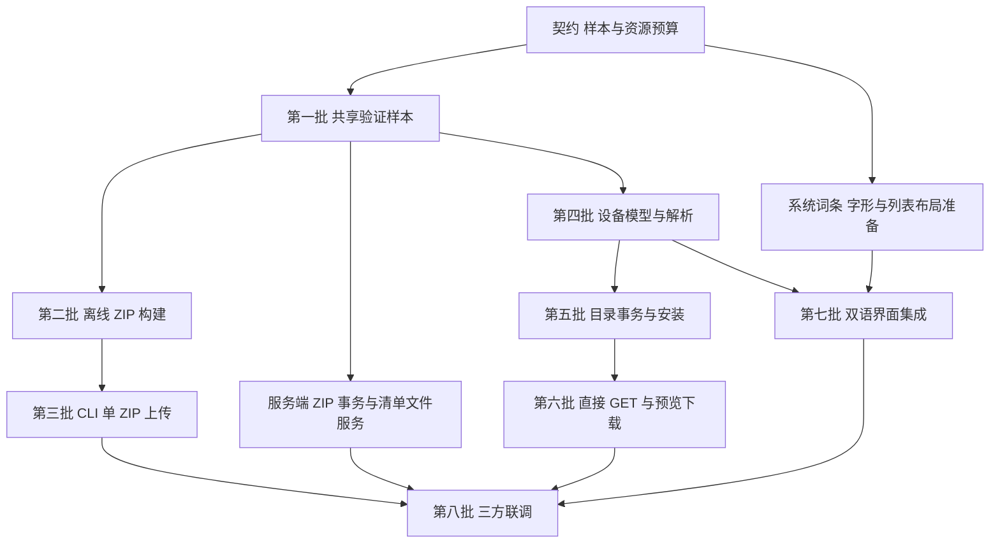

# Mosaico Ideas 文件发布实施计划

状态（2026-10-14）：本计划的 CLI、测试服务器、设备目录存储和双语代码已落地。
原始任务拆分保留供评审；实际入口、运行命令及验证范围以[联调说明](testing.zh-CN.md)为准。
生产账户/审核接入、容量压力和真实断电耐久测试仍为后续验收。

本计划对应[文件发布与设备下载协议草案](README.zh-CN.md)：一个 ZIP 上传、设备同一次 GET 携带能力并直接获取最新兼容发布的外层 manifest、目录化保存、系统及 Ideas 中英离线切换。Vibe Mode 自更新是独立工作，不在本计划内；本计划不提供 V0.1 兼容支持。

实施分为协议与样本准备、离线打包与验证、上传通路、设备内容解析、目录事务、直接下载和双语 UI，最后做完整联调。服务端、工具和设备可以在新版共享样本确定后分别开发，验收范围为新版上传、下载、目录事务和双语功能。

首版约定已于 2026-10-14 纳入协议：设备图标固定 64×64、每通道 8 bit RGBA PNG、非交错、无动画、最多 64 KiB；网站图片采用单帧 JPEG/PNG/GIF/WebP、宽高各最多 4096 px、每张最多 10 MiB，封面最多 9 张；ZIP 原始大小和外层解压后总量各最多 100 MiB。图标在 ZIP 冻结前等比缩放、居中透明补边，服务端只校验并拒绝不合格内容。完整容量、字段和接口默认值以[协议正文](README.zh-CN.md)为准，以下工作落实这些约定。

## 开始实现前需要完成的工作

| 准备项 | 具体交付 | 阻塞范围 |
| --- | --- | --- |
| 图片校验与样本 | 按已确认编码、像素和源图限制制作有效/无效样本，设置解码器额外内存和 CPU 预算 | 内容校验实现与验收 |
| HTTP 机器可读契约 | 把两个 multipart 部分、状态/回执/错误、带能力的 manifest GET、ETag、缓存、幂等及默认时限落实为 OpenAPI 和响应样本 | 上传客户端与服务器联调、设备 HTTP 实现 |
| 作者配置和展示生成 | 映射中英文字/字体/源图与预生成目录两种互斥输入；实现 package/validate/upload 入口及参数，无应用编号也能生成展示文件 | 完整 ZIP 构建 |
| 双语 UI 资源与版面 | 系统词条、中文字体、首次中文与偏好持久化，My Ideas 复用 name 字形块的行高或卡片布局 | UI、资源生成与固件容量验收 |
| 设备容量和存储验证方案 | 在已确认文件容量上限下测量 Flash/PSRAM 峰值，验证目录事务各中断点恢复 | 容量验收与实机发布 |
| 真实联调夹具 | 一个可验证的双语 Idea、其 ZIP、所有 manifest/文件和预期摘要、固定 HTTP 响应 | 三方一致性和端到端验收 |

现有两个 JSON Schema 只描述内容清单，实际图片校验必须读取文件。按协议补机器可读的上传/查询/选版 API 定义及 HTTP 响应样本，本次已在本目录新增 api.openapi.yaml，避免各端自行解释 multipart 字段、能力参数、异步状态和错误格式。

直接 GET 按 profile、chip_id、flash_size、recovery_version 筛选可见发布，再按首次发布时间选择最新兼容版本；无兼容候选返回 409 NO_COMPATIBLE_RELEASE。固定 release_id 请求只返回指定版本，设备仍独立校验兼容性；任何路径都不增加 resolve 步骤。

ZIP 原始大小及外层解压总量各 100 MiB、外层清单 64 KiB、设备 32 MiB/32 个文件、上传 164 个文件/512 个 ZIP 条目及字段上限均作为验收要求。网关须允许 ZIP 加 multipart 开销，按协议的可配置默认值设置请求时限，后台校验资源预算单独设置。设备须计入 JSON 解析树、文件索引、预览像素、网络缓冲和 NAND 开销，不能只按清单长度估算内存。

实现前的本地 factory.bin 样本为 1,799,520 字节；本次最终候选 vibe-mode.bin 为 1,774,160 字节，Vibe Mode 固定槽为 1,835,008 字节，余量 60,848 字节。此数据只对应本次测试配置，后续版本仍须重新检查预算。若装不下，先调整代码/字形资源方案，不在普通 Idea 上传工作中暗改产品布局。

### 作者侧输入与命令边界

保留 mosaico-ideas.json 作为作者配置入口，发布 manifest 由工具生成。为作者配置定义显式的双语输入；不要把网站 title 自动充当两种语言的设备名称，也不要在上传途中请求服务器临时翻译。

首版同时支持两种输入：默认从各语言的文字、字体和可选源图生成展示目录，高级用法引用预生成 display/资源。同一语言必须显式选一种，混合配置报错；两种入口都经过同一验证器，生成器的临时 sidecar 不进入 ZIP。`project package` 离线构建，`project validate <zip>` 校验成品，`project upload <zip>` 只上传既有成品。作者字段和命令选项映射在该批次补齐；这些命令和模块已实现，见 mosaico-tools/README.md。

原 prepare_idea_presentation.py 要求 --code，并生成带 code 的 presentation.json；本次已移除该身份依赖和 sidecar。首次上传成功前尚无六位编号，纯展示生成必须去掉对此编号的依赖；可以抽出不含身份的构建函数，命令向 stdout 输出生成文件描述，不保留旧 sidecar。display/1 与 MIFF/1 本身不需要新增应用身份。

## 代码边界与当前差距

以下为现有入口；拟新增模块名在后续批次中单独标明。

| 所属范围 | 代码入口 | 改动重点 |
| --- | --- | --- |
| 上传作者配置 | [ideas_archive.py](../../tools/mosaico_cli/ideas_archive.py)、mosaico-ideas.schema.json | 解析作者输入与双语来源，保留本地预检；上传前不再把 Markdown 相对链接改成线上 URL |
| 上传编排 | [platform_upload.py](../../tools/mosaico_cli/platform_upload.py) | 从逐文件任务改成校验/复用既有 ZIP、一次上传、查询完成回执；不提前创建空应用 |
| HTTP 客户端 | [platform_client.py](../../tools/mosaico_cli/platform_client.py) | 新增从磁盘流式传输 request/package 两部分；现有 multipart 以 bytes 拼接整个请求，不适合 100 MiB 包 |
| CLI 入口 | [cli.py](../../tools/mosaico_cli/cli.py) | 实现 `project package`、`project validate <zip>` 和 `project upload <zip>`，保留明确 create/update 选择 |
| 展示生成 | [prepare_idea_presentation.py](../../../esp-mosaico-vibe-mode/firmware/vibe-mode/tools/prepare_idea_presentation.py)、[ideas_font.py](../../../esp-mosaico-vibe-mode/firmware/vibe-mode/tools/ideas_font.py) | 去掉生成资源对 code 的依赖，生成并校验两个独立语言目录 |
| 设备内容模型 | [ideas_package.c](../../../esp-mosaico-vibe-mode/firmware/vibe-mode/components/app_ideas/src/ideas_package.c)、[ideas_package.h](../../../esp-mosaico-vibe-mode/firmware/vibe-mode/components/app_ideas/private/ideas_package.h) | 从单一平铺 download/1 模型改成根清单、内层固件、双语资源的分阶段解析和统一内部索引 |
| NAND 存储 | [ideas_store.c](../../../esp-mosaico-vibe-mode/firmware/vibe-mode/components/app_ideas/src/ideas_store.c) | 当前清理明确拒绝子目录；增加受限目录创建、遍历、验证、删除和事务恢复 |
| 下载和安装编排 | [factory_ideas.c](../../../esp-mosaico-vibe-mode/firmware/vibe-mode/components/app_ideas/src/factory_ideas.c) | 替换 POST resolve；固定根摘要，按引用获取文件，保留预览确认与安装分离 |
| 展示解析 | [ideas_presentation.c](../../../esp-mosaico-vibe-mode/firmware/vibe-mode/components/app_ideas/src/ideas_presentation.c)、[ideas_presentation.h](../../../esp-mosaico-vibe-mode/firmware/vibe-mode/components/app_ideas/include/ideas_presentation.h) | 当前依赖外层重复的 name/description/locale/fonts；改成以 display 和已验证目录资源为输入 |
| 系统 UI | [vibe_ui.c](../../../esp-mosaico-vibe-mode/firmware/vibe-mode/components/app_ui/src/vibe_ui.c)、[ui/main.json](../../../esp-mosaico-vibe-mode/firmware/vibe-mode/ui/main.json)、[Kconfig.projbuild](../../../esp-mosaico-vibe-mode/firmware/vibe-mode/main/Kconfig.projbuild) | 英文常量改词条，首次默认中文，持久化运行时偏好；列表复用 name 字形块并支持离线切换 |
| NOR 安装入口 | [factory_nand_update.c](../../../esp-mosaico-vibe-mode/firmware/vibe-mode/components/app_nand_update/src/factory_nand_update.c) | 核对新清单路径；现有组件已相对于安装清单父目录解析，优先复用 |
| 服务端 | 由服务端仓库实现 | ZIP 接收与校验、草稿事务、派生发布、manifest/blob GET；本仓库提供契约和对照样本 |

ESP-Iris 继续负责通用 irisfw 解析和安装契约，工具复用公共主机 API。目录化下载属于 ESP-Mosaico 产品层，不需要把网站元数据、Idea 语言目录或上传事务放进 Iris 通用协议。保护分区规则、公开 Recovery ABI 和维护入口保持稳定。

## 建议的实现批次

### 第一批 共享样本与离线内容验证

先建立唯一的跨端测试样本及预期结果，再写相互对照的校验器。产品样本可放在 esp-mosaico-vibe-mode/tests/fixtures/ideas_file_release/，工具测试引用这一份数据；作者配置专属用例留在 mosaico-tools/tests。测试不能依赖消费工作区的应用或私有路径。

拟在 mosaico-tools 的主机代码新增 ideas_release.py，负责普通 Idea 发布清单、路径、依赖闭包、大小及内容一致性；调用已有 Iris API 验证固件。服务端可以复用相同实现或用自身语言实现，但必须运行同一批输入/预期结果，不能只比较 Schema 是否通过。

交付样本区分两类：主机单元测试可以使用明确标注的合成内容；完整联调用样本必须包含有效分区表、可识别的应用镜像、两种语言的真实 display/MIFF/PNG。当前文档中的占位摘要不能作为完整联调样本。

通过条件：有效集合通过，路径逃逸、大小写冲突、重复键、缺第二语言、错误摘要、组件用途/保护区不符等拒绝；图标非 64×64、非 8 bit RGBA、交错、动画或超过 64 KiB，以及网站图片超像素/数量/大小或含动画均拒绝。覆盖 Unicode 码点与 UTF-8 字节数、单项与集合总量计数，所有声明与实际文件可对照。样本准备不连接设备、不上传生产服务。

### 第二批 双语发布目录与 ZIP 构建

在已有作者配置和展示工具基础上，新增 ideas_archive.py 负责物化发布目录、生成根 manifest、确定性 ZIP 与 ZIP 自检；模块名为建议。固件包作为原样文件放入 firmware/，两种语言自包含，网站 Markdown 保留相对链接。

图标源图先按单帧、10 MiB、4096 px 限制验证，再等比缩放、居中透明补边，生成 64×64、8 bit RGBA、非交错、无动画 PNG；预生成图标执行同一成品校验。project package 完成离线的“作者配置 → 完整目录 → release.zip → 自检报告”，project validate 可独立复查。原件读取完并冻结后再计算归档摘要；失败产物不作为可上传 ZIP。project upload 上传既有成品并复用验证器，不调用构建流程，重试不重新生成归档。

通过条件：首次创建尚无 code 也能打包；无未声明的 presentation.json 等 sidecar；稳定输入在固定构建环境下可复现；原输入变化不会在已开始上传的包中生效；解包和 Iris 内容校验均通过。

### 第三批 单 ZIP 上传与服务端事务

客户端修改 platform_client.py、platform_upload.py 及相应 CLI 集成。multipart 以文件流发送，不把 ZIP 和包装反复复制进内存；流可重新打开用于完整请求重试。落实协议的连接/传输/查询默认时限、2/4/8/10 秒轮询、最多额外 3 次故障重试和 Retry-After；等待 10 分钟后保留 upload_id，不把后台任务误报为 failed。

本地上传记录由逐文件完成表改为：server、账号/目标、请求元数据、ZIP 路径/大小/摘要、幂等键、upload_id 和最终回执。进程重启后重新核验 ZIP；取得 upload_id 后优先 GET 状态，未取得则以原幂等键重传。不得把鉴权凭据或内容本身复制进状态文件。

服务端对应交付：有界接收 ZIP、解包验证、持久校验任务、创建/更新草稿事务及完成回执。首次创建身份由成功事务分配；更新做并发版本检查；完整发布就绪后才更新兼容选版的可见发布索引。失败记录及幂等绑定保留 7 天，成功回执和绑定至少覆盖关联草稿/发布存续期，清理不得影响被引用对象。站点渲染仍负责解析 Markdown 本地资源链接，服务端不通过缩图、转码或修改清单修复不合格发布文件。

通过条件：只上传一个 package，无逐文件接口；断线、丢响应、服务器重启、重复请求和并发更新均不重复创建应用、不覆盖他人草稿；错误可定位到包内文件；上传成功始终只产生草稿。

服务端同时可实现 manifest 与 blob GET，设备团队以静态测试服务开发，不必等完整网站发布界面完成。

### 第四批 设备内容模型与新格式解析

将解析器拆成可在主机测试的阶段：解析/验证外层 manifest → 获取并验证内层固件清单 → 展开组件索引 → 验证所选 display 与资源。完成内容验证后才向 UI 暴露可确认预览；确认下载后再验证完整集合。

内部文件条目分别表示相对路径、大小和摘要；网络 URL 由摘要派生。内部允许建立文件索引和缓存 display 派生元数据，这不等于在线格式需要再加一份 files 表。明确 JSON 缓冲、字体字节和像素缓冲的所有者与释放时机，防止切换语言或取消后悬空引用。

仅实现本文定义的新格式解析，校验通过后生成内部安装模型并执行产品安全检查。未知 schema 或内容校验失败直接拒绝，不新增旧格式读取器、转换器或失败回退分支。当前 download/1 示例只用于理解现有实现。

通过条件：真实 C 解析器运行在 host 测试中，通过新版共享向量；未知格式、错误目标、错误最低版本和保护区写入均拒绝。

### 第五批 NAND 目录事务与离线安装

修改 ideas_store.c 的所有路径、枚举、容量统计、恢复和清理入口，不能只放宽 filename 校验。文件写入使用受控相对路径，递归清理不跟随链接、不离开当前发布目录；根清单原始字节与 firmware/manifest.json 各自保存。

定义 current/incoming/previous 的提交记录、同步步骤和开机恢复判据；主机注入 mkdir、写入、校验、同步、rename、清理失败，设备上验证 LittleFS 对应的持久性。故障恢复只选择完整且验证通过的一代，不能因为 current 存在就删除唯一可用的 previous。

普通 Idea 安装入口从 current/manifest.json 改为 current/firmware/manifest.json；外层内容清单不能误交给 NOR 写入器。内层组件仍为相对于安装清单的 basename，优先不改 Iris 安装格式和写入后端。

通过条件：同名中英资源共存；部分下载不替换旧 current；目录事务各中断点可恢复；离线重校验和安装有效；原 NOR 开机身份与 NAND 最新版本继续独立。

### 第六批 直接获取 manifest 与下载确认

修改 factory_ideas.c，首个请求直接 GET /api/v1/ideas/{code}/manifest.json，附带设备实值 profile/chip_id/flash_size/recovery_version。服务端返回最新兼容发布；设备读取并校验强 ETag、响应原始字节和容量，验证根清单后按摘要获取内层清单、当前语言展示及后续文件。新通路不得调用 resolve 或获取临时下载 URL。

预览不写 NAND、不下载固件镜像。固定 release_id、根摘要和请求代号后等待用户；确认时复用已验证资源并获取另一语言及组件，取消或过期响应不能触发写入。全部内容通过后提交目录；下载成功不修改 NOR、不重启。

通过条件：抓取 HTTP 请求序列证明第一步即带能力 GET 并直接返回完整 manifest；最新发布不兼容时选中较旧兼容发布，无兼容候选返回 409 NO_COMPATIBLE_RELEASE。显式 release_id 不替换版本，预览后切换服务器发布不混入新版；弱/缺失/不符 ETag、超限/截断响应、400/404、限流、离线、取消与重复确认均有明确行为。

### 第七批 系统与 Ideas 双语 UI

新增轻量的词条映射与语言设置模块，具体命名可为 vibe_i18n.c/h。系统菜单、按钮、状态、错误和确认文字使用稳定词条 ID；协议 ID、错误码及固件版本保留原值。设备后端输出可翻译的状态标识和参数，避免继续散落英文展示字符串。

zh-CN/en 偏好保存到独立设置键，不能覆盖开机应用身份；首次默认 zh-CN，设置提供 English，后续启动使用已保存偏好。离线切换更新当前页面、列表和详情，只按需加载当前语言及当前可见项目的资源，两套文件始终保留在 NAND；Idea 的 default_locale 不修改全局语言。

My Ideas 列表复用现有 display 的 name 字形块，提供完整绘制区域，必要时增加行高或采用卡片布局；不能把固定字形块当通用字体任意重排。首版不新增列表专用描述文件、字体副本或排版资源。

通过条件：无网络、无已下载 Idea 时系统仍可中英切换；下载后列表/详情均支持两种语言；重启保留偏好；缺失或损坏语言资源按内容异常规则处理，不接受单语言降级；固件体积及运行峰值在预算内。

### 第八批 三方联调与发布准备

将一次真实流程串起来：离线生成双语 ZIP → 创建/更新草稿 → 发布测试快照 → 设备直接取 manifest → 预览/取消或确认 → 双语文件完整提交 → 断网切换 → 离线设置开机应用。

补充 ZIP 网关限额、客户端进程重启、上传事务重启、服务端切换发布、断网、NAND 空间不足与写入中断、未知格式拒绝、UI 字形边界等场景。必须区分文件下载完成、内容校验完成与 NOR 安装完成三个结果。

服务端先准备新接口，工具和新版设备通过测试环境验收后再开放新格式发布。现有设备通过既有部署路径获得首个支持版本，本计划不增加自更新流程。已审核 Vibe Mode 预编译包在替代物通过清单、布局、摘要和设备验证前保留。

## 依赖关系与优先级

数字表示可审查的提交批次，不要求所有工作串行。服务端在第一批后即可开发；系统词条、字形资源和版面预算可以提前推进。

建议第一轮落地范围是共享有效/无效样本、作者双语输入定义、与编号解耦的展示生成、离线 ZIP 构建和验证。它可以在没有服务端、没有设备写入的情况下形成可检查的产物，供服务器同事和设备解析器共同使用。

## 验证要求与完成标准

| 改动 | 主要检查 |
| --- | --- |
| 打包与上传 | 扩展 mosaico-tools/tests/test_platform.py，并将 ZIP/发布内容的独立测试按职责拆出；验证流式传输、冻结字节和幂等行为 |
| 解析与展示 | 扩展 esp-mosaico-vibe-mode/tests/test_ideas_store.py、test_ideas_presentation_host.py、test_ideas_display.py，执行真实 C 校验逻辑 |
| 目录事务 | 新增失败注入与完整性恢复场景；未识别内容不得误认成完整新包或自动清空；主机结果不能代替实际 LittleFS 断电验证 |
| 双语 UI | 系统词条覆盖、中文列表/详情实机检查、切换与重启、Flash/PSRAM 峰值测量 |
| 公共应用集成 | 运行 mosaico-tools/tests 和 esp-mosaico-vibe-mode/tests；涉及 Iris 时追加其 Python 测试并保持 Python 3.8 兼容 |
| 最终固件 | 经验证的 ESP-IDF 6.2+、ESP32-S31 构建，产品布局/保护区及真实设备验收 |

测试应验证可观察行为和失败恢复，不以搜索源码里出现某个字符串代替功能测试。文档中的声明和 Schema 校验不能当作 ZIP 解包、HTTP、内存预算或真实镜像的验收证据。

所有设备操作经消费工作区的 mosaico.py；本计划阶段不执行设备写入。实施完成的判据是新版上传/下载、目录事务、系统和 Ideas 双语均按契约运行且通过验收，不以“能成功下载一个 JSON”作为完成标志。
